# `pyflayer.errors`

Library-defined exceptions are declared in `pyflayer.errors`. Their actual inheritance and
constructors are rendered from source below. Python built-in exceptions may also be raised by
operations; this page does not claim that every failure derives from `PyFlayerError`.

::: pyflayer.errors
    options:
      members:
        - PyFlayerError
        - ProtocolError
        - MalformedPacket
        - UnknownPacket
        - FramingError
        - CompressionError
        - StateError
        - UnsupportedVersion
        - UnsupportedType
        - ConnectionClosed
        - AuthError
        - LoginRejected
        - KickedError
        - DataError
        - MissingRegistryEntry
        - WorldError
        - ChunkNotLoaded
        - OutOfWorldBounds
        - ActionError
        - ActionBusy
        - ActionPreempted
        - ActionCancelled
        - ActionFailed
        - LeaseRevoked
        - PathError
        - NoPath
        - PathTimeout
        - ExtensionError
        - ExtensionNotLoaded
        - ExtensionAlreadyLoaded
        - ExtensionFailed
      show_root_heading: false
    show_root_toc_entry: false

<!--

The exception tree for PyFlayer. Every error raised by library code derives from
:class:`PyFlayerError` (ADR-10). Errors carry structured fields so callers can react
without parsing strings.

```python
from pyflayer.errors import PyFlayerError, KickedError, ProtocolError

try:
    raise KickedError("kicked by server", reason="disconnected")
except KickedError as exc:
    print(exc.fields["reason"])
```

## Version constants

The package is distributed on PyPI as **`mcflayer`**; the import name is **`pyflayer`**.

::: pyflayer.errors
    options:
      show_root_heading: false
      show_root_toc_entry: false

## Error catalog

| Error | Module | Raised when |
|---|---|---|
| `PyFlayerError` | `pyflayer.errors` | Base class for all pyflayer errors |
| `ProtocolError` | `pyflayer.errors` | Framing, codec and state-machine errors |
| `MalformedPacket` | `pyflayer.errors` | Bytes did not match the wire format |
| `UnknownPacket` | `pyflayer.errors` | A packet id has no registered codec |
| `FramingError` | `pyflayer.errors` | A frame length prefix or frame body was invalid |
| `CompressionError` | `pyflayer.errors` | Compressed payload did not match its declared size |
| `StateError` | `pyflayer.errors` | An illegal connection-state transition |
| `UnsupportedVersion` | `pyflayer.errors` | No data is available for the requested version |
| `UnsupportedType` | `pyflayer.errors` | The protodef compiler met an unimplemented type |
| `ConnectionClosed` | `pyflayer.errors` | The peer closed the connection |
| `AuthError` | `pyflayer.errors` | Authentication failed |
| `LoginRejected` | `pyflayer.errors` | The server refused the login |
| `KickedError` | `pyflayer.errors` | The server kicked the connected client |
| `DataError` | `pyflayer.errors` | minecraft-data could not be loaded |
| `MissingRegistryEntry` | `pyflayer.errors` | A registry lookup failed |
| `WorldError` | `pyflayer.errors` | Base class for world/chunk errors |
| `ChunkNotLoaded` | `pyflayer.errors` | A block was requested in an unloaded chunk |
| `OutOfWorldBounds` | `pyflayer.errors` | A coordinate lies outside the dimension's range |
| `ActionError` | `pyflayer.errors` | Base class for action-scheduler errors |
| `ActionBusy` | `pyflayer.errors` | A conflicting action holds the requested resources |
| `ActionPreempted` | `pyflayer.errors` | A higher-priority action took over the lease |
| `ActionCancelled` | `pyflayer.errors` | The action's handle was cancelled by user code |
| `ActionFailed` | `pyflayer.errors` | The action raised while running |
| `LeaseRevoked` | `pyflayer.errors` | A revoked lease was used to write controls |
| `PathError` | `pyflayer.errors` | Base class for pathfinder errors |
| `NoPath` | `pyflayer.errors` | No path exists to the goal |
| `PathTimeout` | `pyflayer.errors` | The search budget was exhausted |
| `ExtensionError` | `pyflayer.errors` | Base class for ext loader errors |
| `ExtensionNotLoaded` | `pyflayer.errors` | The extension is not currently loaded |
| `ExtensionAlreadyLoaded` | `pyflayer.errors` | The extension is already loaded |
| `ExtensionFailed` | `pyflayer.errors` | Loading, unloading or reloading an extension failed |

## Structural overview

```mermaid
graph TD
    PyFlayerError --> ProtocolError
    PyFlayerError --> AuthError
    PyFlayerError --> DataError
    PyFlayerError --> WorldError
    PyFlayerError --> ActionError
    PyFlayerError --> PathError
    PyFlayerError --> ExtensionError
    
    ProtocolError --> MalformedPacket
    ProtocolError --> UnknownPacket
    ProtocolError --> FramingError
    ProtocolError --> CompressionError
    ProtocolError --> StateError
    ProtocolError --> UnsupportedVersion
    ProtocolError --> UnsupportedType
    
    WorldError --> ChunkNotLoaded
    WorldError --> OutOfWorldBounds
    
    ActionError --> ActionBusy
    ActionError --> ActionPreempted
    ActionError --> ActionCancelled
    ActionError --> ActionFailed
    ActionError --> LeaseRevoked
    
    PathError --> NoPath
    PathError --> PathTimeout
    
    ExtensionError --> ExtensionNotLoaded
    ExtensionError --> ExtensionAlreadyLoaded
    ExtensionError --> ExtensionFailed
```



## Quick example

```python
import pyflayer
from pyflayer.errors import KickedError

try:
    await bot.run()
except KickedError as exc:
    print(f"Kicked: {exc.message}")
    print(f"Reason: {exc.fields.get('reason')}")
```